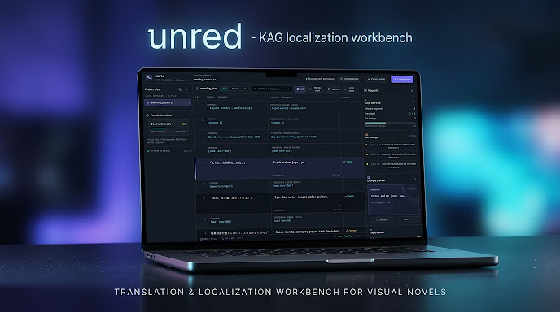

<p align="center">
  
</p>

<p align="center">
  <strong>KAG Localization Workbench & Quality Control Suite</strong><br>
  <em>An interactive prototype & simulation workbench for visual novel script quality control.</em>
</p>

<p align="center">
  
  
  
  
  
  
</p>

<p align="center">
  <a href="https://unred-omega.vercel.app/"><strong>🌐 Open Web Demo (Simulation) »</strong></a>
  &nbsp;&bull;&nbsp;
  <a href="https://github.com/Unjou/mojibake_QC-sc"><strong>📦 Python Script Repository »</strong></a>
</p>

<p align="center">
  
</p>

---

> ⚠️ **Status Notice — SIMULATION & DEMO PROTOTYPE:**  
> The web version of **unred** currently operates as an **interactive prototype / workflow simulation (UI demo)**. It illustrates how visual novel KAG scripts are parsed into spoken dialogue segments, evaluated by QA inspection modules, and previewed in a simulated game message box. The web demo does not yet perform full automated batch processing for massive production files; it serves as a functional demonstration of the planned workbench workflow.

---

## 📌 About unred

**unred** is a specialized workbench and quality control (QC) suite tailored specifically for translators, editors, and localization teams working with **Kirikiri / Kirikiri2 (KAG)** visual novel engines (`.ks`, `.tjs`, `.txt`).

Visual novel localization frequently encounters issues such as lost line markers, damaged engine syntax tags (`@bg`, `[name]`, `[wait]`), lines exceeding the message box character boundaries, and lingering Japanese Kanji/Kana characters (*leftover text*). **unred** isolates spoken dialogue from game engine instructions, streamlines side-by-side bilingual review, and pinpoints script anomalies with high precision.

---

## Key Modules & Features

<table>
  <tr>
    <td width="50%" valign="top">
      <h3> Smart Syntax Isolation</h3>
      <p>Separates character dialogue from underlying KAG engine commands (such as <code>@bg storage</code>, <code>*scene</code>, and macro tags like <code>[name]</code>), safeguarding game engine syntax against accidental corruption.</p>
    </td>
    <td width="50%" valign="top">
      <h3> Line Length & Overflow Guard</h3>
      <p>Calculates half-width character thresholds in real time (e.g., 42/64 character limits) to prevent translated text from overflowing or getting clipped in the game window.</p>
    </td>
  </tr>
  <tr>
    <td width="50%" valign="top">
      <h3> JP Leftover & Untranslated Hunter</h3>
      <p>Automatically flags lingering Kanji, Hiragana, or Katakana characters that were missed during translation, as well as blank lines or skipped dialogue segments.</p>
    </td>
    <td width="50%" valign="top">
      <h3> In-Engine Dialogue Previewer</h3>
      <p>Instant live preview panel displaying exactly how translated sentences will appear inside the visual novel message box and subtitle window.</p>
    </td>
  </tr>
  <tr>
    <td width="50%" valign="top">
      <h3> Pronoun & Register Consistency</h3>
      <p>Scans for mismatched pronouns (he/she/they) and stylistic register anomalies to ensure natural dialogue tone fitting each character's established persona.</p>
    </td>
    <td width="50%" valign="top">
      <h3> Browser-Only Client Workspace</h3>
      <p>Complete script privacy. Your translation files are never uploaded to remote third-party servers; all parsing and QA checks execute locally in the browser.</p>
    </td>
  </tr>
</table>

---

## Supported Formats & File Types

| Category | Supported Extensions & Formats |
| :--- | :--- |
| **Kirikiri / KAG Scripts** | `.ks`, `.tjs`, `.ks.scn` |
| **Plain Text / Scenario Files** | `.txt`, `.txt.scn` |
| **Recognized Line Marker Patterns** | `p1`, `p2`, `l1`, `l2`, `msg1`, `dialog1`, `[p1]`, `// p1:`, `p1 =` |

---

## Running the Python Script (Desktop)

This repository includes the core Python desktop script (`JPLeftoverHunter.pyw`):

### 1. Prerequisites
- Python 3.8 or higher
- `pip` package manager

### 2. Dependency Installation
```bash
# Clone the repository
git clone https://github.com/Unjou/mojibake_QC-sc.git
cd mojibake_QC-sc

# Install required libraries
pip install PyQt5 chardet deep-translator
```

### 3. Running the Script
```bash
python JPLeftoverHunter.pyw
```

### 4. Rebuilding the Executable (.exe) with PyInstaller
To package the tool into a standalone portable Windows executable (`.exe`):
```bash
pip install pyinstaller
pyinstaller --onefile --windowed --name="unred-QC" JPLeftoverHunter.pyw
```
The compiled executable will be located in the `dist/unred-QC.exe` directory.

---

## Web Preview (Online Demo)

Access the live interactive web demo at: **[unred-omega.vercel.app](https://unred-omega.vercel.app/)**

- **Zero Installation:** Open directly in any modern web browser.
- **Client-Side Simulation:** Features bilingual side-by-side script comparison, segment readiness status (`2/5 Segments ready`), QA findings inspector, and simulated in-engine dialogue preview.

---

## Roadmap

- [ ] Full in-browser KAG parser integration (WebAssembly / pure TypeScript parser).
- [ ] Official multiplatform desktop standalone builds (Windows & macOS).
- [ ] Support for additional visual novel script engines (Ren'Py, BGI/Ethornell, Artemis Engine).
- [ ] Custom glossary and terminology consistency QA validator.

---

## License

Distributed under the **MIT License**. See `LICENSE` for more information.
